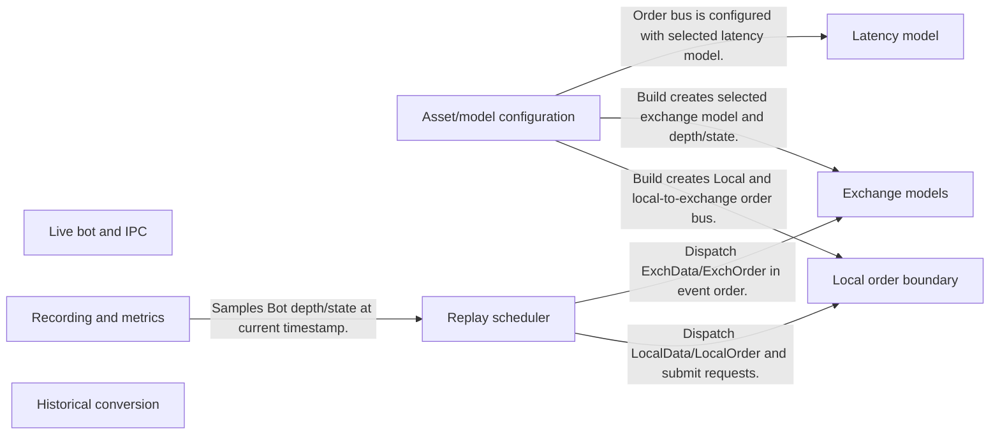
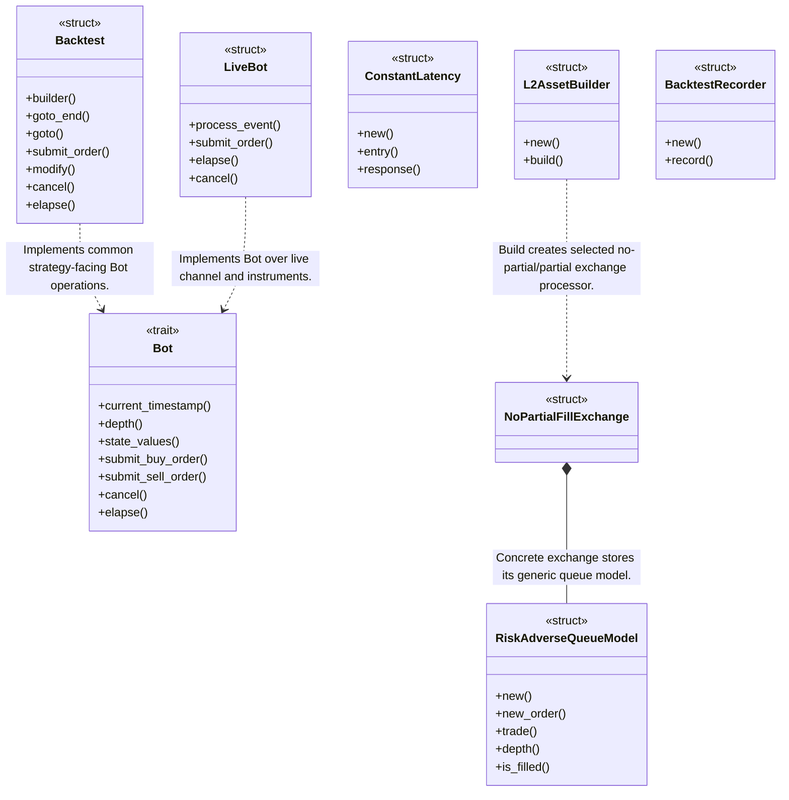
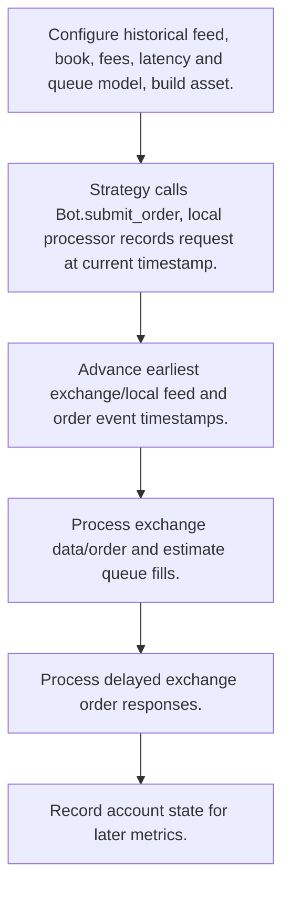
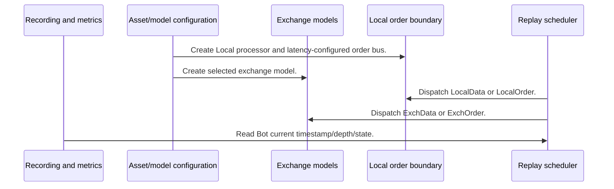

# HftBacktest: workflow, design and architecture

Updated: **2026-10-13**
Reviewed Git hash: `88fb0ea437128d75a7c33e12e9bb4b2323b8e219`
Branch: `feature/ayu_develop`
Source diff SHA256: `e3b0c44298fc1c149afbf4c8996fb92427ae41e4649b934ca495991b7852b855`
Scope: **Market replay and live bot engine** / Maintenance: **active**
Languages: Rust, Python

[HTML edition](ayu-develop.html) / [Development](development.md) / [Historical validation](validation.md) / [Full system comparison](../../docs/index.html)

## Purpose and scope

Rust/Python high-frequency market replay with separate exchange/local processors, configurable latency/queue/fee models and a shared Bot interface for live connector deployment.

## Features and support boundaries

Native = implemented here. Integration = supplied through a named host/API. Limited = material restriction. Not provided = evidenced scope exclusion. Unverified = support/absence not established. Not applicable = outside this artifact type.

| Capability | Status | Implementation and limits | Source |
|---|---|---|---|
| Backtesting | Native | Timestamp scheduler and Bot order/time API operate real replay/local/exchange model boundaries. | [goto](../hftbacktest/src/backtest/mod.rs) ([L755](https://github.com/alexcwyu/hftbacktest/blob/88fb0ea437128d75a7c33e12e9bb4b2323b8e219/hftbacktest/src/backtest/mod.rs#L755)) / [submit_order](../hftbacktest/src/backtest/mod.rs) ([L982](https://github.com/alexcwyu/hftbacktest/blob/88fb0ea437128d75a7c33e12e9bb4b2323b8e219/hftbacktest/src/backtest/mod.rs#L982)) / [Bot](../hftbacktest/src/types.rs) ([L784](https://github.com/alexcwyu/hftbacktest/blob/88fb0ea437128d75a7c33e12e9bb4b2323b8e219/hftbacktest/src/types.rs#L784)) / [build](../hftbacktest/src/backtest/mod.rs) ([L254](https://github.com/alexcwyu/hftbacktest/blob/88fb0ea437128d75a7c33e12e9bb4b2323b8e219/hftbacktest/src/backtest/mod.rs#L254)) |
| Live execution | Integration | LiveBot sends LiveRequest orders over Channel and handles connector feed/account events; live venues require a separately configured connector and credentials. | [LiveBot](../hftbacktest/src/live/bot.rs) ([L195](https://github.com/alexcwyu/hftbacktest/blob/88fb0ea437128d75a7c33e12e9bb4b2323b8e219/hftbacktest/src/live/bot.rs#L195)) / [hftbacktest/Cargo.toml](../hftbacktest/Cargo.toml) ([L24](https://github.com/alexcwyu/hftbacktest/blob/88fb0ea437128d75a7c33e12e9bb4b2323b8e219/hftbacktest/Cargo.toml#L24)) |
| Paper trading | Unverified | Not established by the inspected implementation boundaries; no absence or production claim is made. | Not applicable to this repository scope. |
| Event driven | Native | Timestamp scheduler and Bot order/time API operate real replay/local/exchange model boundaries. | [goto](../hftbacktest/src/backtest/mod.rs) ([L755](https://github.com/alexcwyu/hftbacktest/blob/88fb0ea437128d75a7c33e12e9bb4b2323b8e219/hftbacktest/src/backtest/mod.rs#L755)) / [submit_order](../hftbacktest/src/backtest/mod.rs) ([L982](https://github.com/alexcwyu/hftbacktest/blob/88fb0ea437128d75a7c33e12e9bb4b2323b8e219/hftbacktest/src/backtest/mod.rs#L982)) / [Bot](../hftbacktest/src/types.rs) ([L784](https://github.com/alexcwyu/hftbacktest/blob/88fb0ea437128d75a7c33e12e9bb4b2323b8e219/hftbacktest/src/types.rs#L784)) / [build](../hftbacktest/src/backtest/mod.rs) ([L254](https://github.com/alexcwyu/hftbacktest/blob/88fb0ea437128d75a7c33e12e9bb4b2323b8e219/hftbacktest/src/backtest/mod.rs#L254)) |
| Vectorized | Unverified | Not established by the inspected implementation boundaries; no absence or production claim is made. | Not applicable to this repository scope. |
| Order management | Native | Timestamp scheduler and Bot order/time API operate real replay/local/exchange model boundaries. | [goto](../hftbacktest/src/backtest/mod.rs) ([L755](https://github.com/alexcwyu/hftbacktest/blob/88fb0ea437128d75a7c33e12e9bb4b2323b8e219/hftbacktest/src/backtest/mod.rs#L755)) / [submit_order](../hftbacktest/src/backtest/mod.rs) ([L982](https://github.com/alexcwyu/hftbacktest/blob/88fb0ea437128d75a7c33e12e9bb4b2323b8e219/hftbacktest/src/backtest/mod.rs#L982)) / [Bot](../hftbacktest/src/types.rs) ([L784](https://github.com/alexcwyu/hftbacktest/blob/88fb0ea437128d75a7c33e12e9bb4b2323b8e219/hftbacktest/src/types.rs#L784)) / [build](../hftbacktest/src/backtest/mod.rs) ([L254](https://github.com/alexcwyu/hftbacktest/blob/88fb0ea437128d75a7c33e12e9bb4b2323b8e219/hftbacktest/src/backtest/mod.rs#L254)) |
| Order types | Native | Inspected no-partial model handles Market and Limit: resting GTC/GTX, fully filled marketable GTC/FOK/IOC, expiring marketable GTX and nonmarketable FOK/IOC. Full taker fills ignore displayed quantity, so FOK/IOC realism is limited. | [ack_new](../hftbacktest/src/backtest/proc/nopartialfillexchange.rs) ([L314](https://github.com/alexcwyu/hftbacktest/blob/88fb0ea437128d75a7c33e12e9bb4b2323b8e219/hftbacktest/src/backtest/proc/nopartialfillexchange.rs#L314)) / [NoPartialFillExchange](../hftbacktest/src/backtest/proc/nopartialfillexchange.rs) ([L64](https://github.com/alexcwyu/hftbacktest/blob/88fb0ea437128d75a7c33e12e9bb4b2323b8e219/hftbacktest/src/backtest/proc/nopartialfillexchange.rs#L64)) |
| Multi venue | Limited | Backtest assets/local/exchange vectors and per-asset states enable multiple modeled assets; no complete cross-venue margin/netting allocator was verified. | [Backtest](../hftbacktest/src/backtest/mod.rs) ([L604](https://github.com/alexcwyu/hftbacktest/blob/88fb0ea437128d75a7c33e12e9bb4b2323b8e219/hftbacktest/src/backtest/mod.rs#L604)) / [BacktestRecorder](../hftbacktest/src/backtest/recorder.rs) ([L33](https://github.com/alexcwyu/hftbacktest/blob/88fb0ea437128d75a7c33e12e9bb4b2323b8e219/hftbacktest/src/backtest/recorder.rs#L33)) |
| Crypto | Integration | Concrete BinanceSpot connector starts configured market/user feed streams and owns client/order manager; runtime requires remote venue settings and credentials. | [BinanceSpot](../connector/src/binancespot/mod.rs) ([L105](https://github.com/alexcwyu/hftbacktest/blob/88fb0ea437128d75a7c33e12e9bb4b2323b8e219/connector/src/binancespot/mod.rs#L105)) / [LiveBot](../hftbacktest/src/live/bot.rs) ([L195](https://github.com/alexcwyu/hftbacktest/blob/88fb0ea437128d75a7c33e12e9bb4b2323b8e219/hftbacktest/src/live/bot.rs#L195)) |
| Equities | Unverified | Not established by the inspected implementation boundaries; no absence or production claim is made. | Not applicable to this repository scope. |
| Futures | Integration | Databento DBN MBO conversion explicitly handles CME SOD snapshot mechanics; data source and instrument contracts are external. | [convert](../py-hftbacktest/hftbacktest/data/utils/databento.py) ([L22](https://github.com/alexcwyu/hftbacktest/blob/88fb0ea437128d75a7c33e12e9bb4b2323b8e219/py-hftbacktest/hftbacktest/data/utils/databento.py#L22)) |
| Options | Unverified | Not established by the inspected implementation boundaries; no absence or production claim is made. | Not applicable to this repository scope. |
| Forex | Unverified | Not established by the inspected implementation boundaries; no absence or production claim is made. | Not applicable to this repository scope. |
| Strategy api | Native | Timestamp scheduler and Bot order/time API operate real replay/local/exchange model boundaries. | [goto](../hftbacktest/src/backtest/mod.rs) ([L755](https://github.com/alexcwyu/hftbacktest/blob/88fb0ea437128d75a7c33e12e9bb4b2323b8e219/hftbacktest/src/backtest/mod.rs#L755)) / [submit_order](../hftbacktest/src/backtest/mod.rs) ([L982](https://github.com/alexcwyu/hftbacktest/blob/88fb0ea437128d75a7c33e12e9bb4b2323b8e219/hftbacktest/src/backtest/mod.rs#L982)) / [Bot](../hftbacktest/src/types.rs) ([L784](https://github.com/alexcwyu/hftbacktest/blob/88fb0ea437128d75a7c33e12e9bb4b2323b8e219/hftbacktest/src/types.rs#L784)) / [build](../hftbacktest/src/backtest/mod.rs) ([L254](https://github.com/alexcwyu/hftbacktest/blob/88fb0ea437128d75a7c33e12e9bb4b2323b8e219/hftbacktest/src/backtest/mod.rs#L254)) |
| Optimization | Unverified | Not established by the inspected implementation boundaries; no absence or production claim is made. | Not applicable to this repository scope. |
| Machine learning | Unverified | Not established by the inspected implementation boundaries; no absence or production claim is made. | Not applicable to this repository scope. |
| Reinforcement learning | Unverified | Not established by the inspected implementation boundaries; no absence or production claim is made. | Not applicable to this repository scope. |
| Portfolio | Limited | Backtest assets/local/exchange vectors and per-asset states enable multiple modeled assets; no complete cross-venue margin/netting allocator was verified. | [Backtest](../hftbacktest/src/backtest/mod.rs) ([L604](https://github.com/alexcwyu/hftbacktest/blob/88fb0ea437128d75a7c33e12e9bb4b2323b8e219/hftbacktest/src/backtest/mod.rs#L604)) / [BacktestRecorder](../hftbacktest/src/backtest/recorder.rs) ([L33](https://github.com/alexcwyu/hftbacktest/blob/88fb0ea437128d75a7c33e12e9bb4b2323b8e219/hftbacktest/src/backtest/recorder.rs#L33)) |
| Risk management | Unverified | Not established by the inspected implementation boundaries; no absence or production claim is made. | Not applicable to this repository scope. |
| Performance analytics | Native | BacktestRecorder saves sampled state; configured metrics compute tabular analysis. | [BacktestRecorder](../hftbacktest/src/backtest/recorder.rs) ([L33](https://github.com/alexcwyu/hftbacktest/blob/88fb0ea437128d75a7c33e12e9bb4b2323b8e219/hftbacktest/src/backtest/recorder.rs#L33)) / [compute_metrics](../py-hftbacktest/hftbacktest/stats/stats.py) ([L23](https://github.com/alexcwyu/hftbacktest/blob/88fb0ea437128d75a7c33e12e9bb4b2323b8e219/py-hftbacktest/hftbacktest/stats/stats.py#L23)) |
| Historical data | Native | Caller-supplied historical NumPy sources and DBN MBO conversion produce replay event data. | [DataSource](../hftbacktest/src/backtest/data/reader.rs) ([L29](https://github.com/alexcwyu/hftbacktest/blob/88fb0ea437128d75a7c33e12e9bb4b2323b8e219/hftbacktest/src/backtest/data/reader.rs#L29)) / [convert](../py-hftbacktest/hftbacktest/data/utils/databento.py) ([L22](https://github.com/alexcwyu/hftbacktest/blob/88fb0ea437128d75a7c33e12e9bb4b2323b8e219/py-hftbacktest/hftbacktest/data/utils/databento.py#L22)) |
| Streaming data | Integration | LiveBot receives feed/order events over configured connector channel. | [LiveBot](../hftbacktest/src/live/bot.rs) ([L195](https://github.com/alexcwyu/hftbacktest/blob/88fb0ea437128d75a7c33e12e9bb4b2323b8e219/hftbacktest/src/live/bot.rs#L195)) |
| Persistence | Native | BacktestRecorder saves sampled state; configured metrics compute tabular analysis. | [BacktestRecorder](../hftbacktest/src/backtest/recorder.rs) ([L33](https://github.com/alexcwyu/hftbacktest/blob/88fb0ea437128d75a7c33e12e9bb4b2323b8e219/hftbacktest/src/backtest/recorder.rs#L33)) / [compute_metrics](../py-hftbacktest/hftbacktest/stats/stats.py) ([L23](https://github.com/alexcwyu/hftbacktest/blob/88fb0ea437128d75a7c33e12e9bb4b2323b8e219/py-hftbacktest/hftbacktest/stats/stats.py#L23)) |
| Data pipeline | Native | Caller-supplied historical NumPy sources and DBN MBO conversion produce replay event data. | [DataSource](../hftbacktest/src/backtest/data/reader.rs) ([L29](https://github.com/alexcwyu/hftbacktest/blob/88fb0ea437128d75a7c33e12e9bb4b2323b8e219/hftbacktest/src/backtest/data/reader.rs#L29)) / [convert](../py-hftbacktest/hftbacktest/data/utils/databento.py) ([L22](https://github.com/alexcwyu/hftbacktest/blob/88fb0ea437128d75a7c33e12e9bb4b2323b8e219/py-hftbacktest/hftbacktest/data/utils/databento.py#L22)) |
| Web ui | Unverified | Not established by the inspected implementation boundaries; no absence or production claim is made. | Not applicable to this repository scope. |
| Cli | Unverified | Not established by the inspected implementation boundaries; no absence or production claim is made. | Not applicable to this repository scope. |
| Monitoring | Unverified | Not established by the inspected implementation boundaries; no absence or production claim is made. | Not applicable to this repository scope. |
| Extension api | Native | Timestamp scheduler and Bot order/time API operate real replay/local/exchange model boundaries. | [goto](../hftbacktest/src/backtest/mod.rs) ([L755](https://github.com/alexcwyu/hftbacktest/blob/88fb0ea437128d75a7c33e12e9bb4b2323b8e219/hftbacktest/src/backtest/mod.rs#L755)) / [submit_order](../hftbacktest/src/backtest/mod.rs) ([L982](https://github.com/alexcwyu/hftbacktest/blob/88fb0ea437128d75a7c33e12e9bb4b2323b8e219/hftbacktest/src/backtest/mod.rs#L982)) / [Bot](../hftbacktest/src/types.rs) ([L784](https://github.com/alexcwyu/hftbacktest/blob/88fb0ea437128d75a7c33e12e9bb4b2323b8e219/hftbacktest/src/types.rs#L784)) / [build](../hftbacktest/src/backtest/mod.rs) ([L254](https://github.com/alexcwyu/hftbacktest/blob/88fb0ea437128d75a7c33e12e9bb4b2323b8e219/hftbacktest/src/backtest/mod.rs#L254)) |
| Native acceleration | Native | Rust replay/models plus Python array interface are compiled; no benchmark ranking inferred. | [Backtest](../hftbacktest/src/backtest/mod.rs) ([L604](https://github.com/alexcwyu/hftbacktest/blob/88fb0ea437128d75a7c33e12e9bb4b2323b8e219/hftbacktest/src/backtest/mod.rs#L604)) / [RiskAdverseQueueModel](../hftbacktest/src/backtest/models/queue.rs) ([L44](https://github.com/alexcwyu/hftbacktest/blob/88fb0ea437128d75a7c33e12e9bb4b2323b8e219/hftbacktest/src/backtest/models/queue.rs#L44)) |
| Distributed execution | Limited | Local live IPC dependencies are explicit; no cross-machine strategy scheduler is established. | [hftbacktest/Cargo.toml](../hftbacktest/Cargo.toml) ([L24](https://github.com/alexcwyu/hftbacktest/blob/88fb0ea437128d75a7c33e12e9bb4b2323b8e219/hftbacktest/Cargo.toml#L24)) / [LiveBot](../hftbacktest/src/live/bot.rs) ([L195](https://github.com/alexcwyu/hftbacktest/blob/88fb0ea437128d75a7c33e12e9bb4b2323b8e219/hftbacktest/src/live/bot.rs#L195)) |

## System components

| Component | Responsibility | Source |
|---|---|---|
| Asset/model configuration | Builds per-asset data reader and processor/model combination. | [L2AssetBuilder](../hftbacktest/src/backtest/mod.rs) ([L134](https://github.com/alexcwyu/hftbacktest/blob/88fb0ea437128d75a7c33e12e9bb4b2323b8e219/hftbacktest/src/backtest/mod.rs#L134)) / [build](../hftbacktest/src/backtest/mod.rs) ([L254](https://github.com/alexcwyu/hftbacktest/blob/88fb0ea437128d75a7c33e12e9bb4b2323b8e219/hftbacktest/src/backtest/mod.rs#L254)) / [DataSource](../hftbacktest/src/backtest/data/reader.rs) ([L29](https://github.com/alexcwyu/hftbacktest/blob/88fb0ea437128d75a7c33e12e9bb4b2323b8e219/hftbacktest/src/backtest/data/reader.rs#L29)) |
| Replay scheduler | Advances local/exchange feed and request event times. | [Backtest](../hftbacktest/src/backtest/mod.rs) ([L604](https://github.com/alexcwyu/hftbacktest/blob/88fb0ea437128d75a7c33e12e9bb4b2323b8e219/hftbacktest/src/backtest/mod.rs#L604)) / [goto](../hftbacktest/src/backtest/mod.rs) ([L755](https://github.com/alexcwyu/hftbacktest/blob/88fb0ea437128d75a7c33e12e9bb4b2323b8e219/hftbacktest/src/backtest/mod.rs#L755)) / [submit_order](../hftbacktest/src/backtest/mod.rs) ([L982](https://github.com/alexcwyu/hftbacktest/blob/88fb0ea437128d75a7c33e12e9bb4b2323b8e219/hftbacktest/src/backtest/mod.rs#L982)) |
| Local order boundary | Submits requests and receives delayed exchange responses. | [build](../hftbacktest/src/backtest/mod.rs) ([L254](https://github.com/alexcwyu/hftbacktest/blob/88fb0ea437128d75a7c33e12e9bb4b2323b8e219/hftbacktest/src/backtest/mod.rs#L254)) / [submit_order](../hftbacktest/src/backtest/mod.rs) ([L982](https://github.com/alexcwyu/hftbacktest/blob/88fb0ea437128d75a7c33e12e9bb4b2323b8e219/hftbacktest/src/backtest/mod.rs#L982)) / [goto](../hftbacktest/src/backtest/mod.rs) ([L755](https://github.com/alexcwyu/hftbacktest/blob/88fb0ea437128d75a7c33e12e9bb4b2323b8e219/hftbacktest/src/backtest/mod.rs#L755)) |
| Exchange models | Reconstructs book and estimates order fills/queue position. | [NoPartialFillExchange](../hftbacktest/src/backtest/proc/nopartialfillexchange.rs) ([L64](https://github.com/alexcwyu/hftbacktest/blob/88fb0ea437128d75a7c33e12e9bb4b2323b8e219/hftbacktest/src/backtest/proc/nopartialfillexchange.rs#L64)) / [RiskAdverseQueueModel](../hftbacktest/src/backtest/models/queue.rs) ([L44](https://github.com/alexcwyu/hftbacktest/blob/88fb0ea437128d75a7c33e12e9bb4b2323b8e219/hftbacktest/src/backtest/models/queue.rs#L44)) / [build](../hftbacktest/src/backtest/mod.rs) ([L254](https://github.com/alexcwyu/hftbacktest/blob/88fb0ea437128d75a7c33e12e9bb4b2323b8e219/hftbacktest/src/backtest/mod.rs#L254)) |
| Latency model | Controls order entry and response delay. | [ConstantLatency](../hftbacktest/src/backtest/models/latency.rs) ([L28](https://github.com/alexcwyu/hftbacktest/blob/88fb0ea437128d75a7c33e12e9bb4b2323b8e219/hftbacktest/src/backtest/models/latency.rs#L28)) / [build](../hftbacktest/src/backtest/mod.rs) ([L254](https://github.com/alexcwyu/hftbacktest/blob/88fb0ea437128d75a7c33e12e9bb4b2323b8e219/hftbacktest/src/backtest/mod.rs#L254)) |
| Live bot and IPC | Uses the Bot interface with live connector channel and feed/order state. | [LiveBot](../hftbacktest/src/live/bot.rs) ([L195](https://github.com/alexcwyu/hftbacktest/blob/88fb0ea437128d75a7c33e12e9bb4b2323b8e219/hftbacktest/src/live/bot.rs#L195)) / [Bot](../hftbacktest/src/types.rs) ([L784](https://github.com/alexcwyu/hftbacktest/blob/88fb0ea437128d75a7c33e12e9bb4b2323b8e219/hftbacktest/src/types.rs#L784)) / [hftbacktest/Cargo.toml](../hftbacktest/Cargo.toml) ([L24](https://github.com/alexcwyu/hftbacktest/blob/88fb0ea437128d75a7c33e12e9bb4b2323b8e219/hftbacktest/Cargo.toml#L24)) |
| Recording and metrics | Persists sampled state and computes research statistics. | [BacktestRecorder](../hftbacktest/src/backtest/recorder.rs) ([L33](https://github.com/alexcwyu/hftbacktest/blob/88fb0ea437128d75a7c33e12e9bb4b2323b8e219/hftbacktest/src/backtest/recorder.rs#L33)) / [compute_metrics](../py-hftbacktest/hftbacktest/stats/stats.py) ([L23](https://github.com/alexcwyu/hftbacktest/blob/88fb0ea437128d75a7c33e12e9bb4b2323b8e219/py-hftbacktest/hftbacktest/stats/stats.py#L23)) |
| Historical conversion | Converts DBN MBO feeds to simulator events. | [convert](../py-hftbacktest/hftbacktest/data/utils/databento.py) ([L22](https://github.com/alexcwyu/hftbacktest/blob/88fb0ea437128d75a7c33e12e9bb4b2323b8e219/py-hftbacktest/hftbacktest/data/utils/databento.py#L22)) |

## Architecture and component boundaries

The component view summarizes inspected responsibility boundaries. Arrows identify the documented API/data dependencies; this is not a deployment-readiness claim.

- Build creates Local and local-to-exchange order bus.: [build](../hftbacktest/src/backtest/mod.rs) ([L254](https://github.com/alexcwyu/hftbacktest/blob/88fb0ea437128d75a7c33e12e9bb4b2323b8e219/hftbacktest/src/backtest/mod.rs#L254))
- Build creates selected exchange model and depth/state.: [build](../hftbacktest/src/backtest/mod.rs) ([L254](https://github.com/alexcwyu/hftbacktest/blob/88fb0ea437128d75a7c33e12e9bb4b2323b8e219/hftbacktest/src/backtest/mod.rs#L254))
- Order bus is configured with selected latency model.: [build](../hftbacktest/src/backtest/mod.rs) ([L254](https://github.com/alexcwyu/hftbacktest/blob/88fb0ea437128d75a7c33e12e9bb4b2323b8e219/hftbacktest/src/backtest/mod.rs#L254))
- Dispatch LocalData/LocalOrder and submit requests.: [goto](../hftbacktest/src/backtest/mod.rs) ([L755](https://github.com/alexcwyu/hftbacktest/blob/88fb0ea437128d75a7c33e12e9bb4b2323b8e219/hftbacktest/src/backtest/mod.rs#L755)) / [submit_order](../hftbacktest/src/backtest/mod.rs) ([L982](https://github.com/alexcwyu/hftbacktest/blob/88fb0ea437128d75a7c33e12e9bb4b2323b8e219/hftbacktest/src/backtest/mod.rs#L982))
- Dispatch ExchData/ExchOrder in event order.: [goto](../hftbacktest/src/backtest/mod.rs) ([L755](https://github.com/alexcwyu/hftbacktest/blob/88fb0ea437128d75a7c33e12e9bb4b2323b8e219/hftbacktest/src/backtest/mod.rs#L755))
- Samples Bot depth/state at current timestamp.: [BacktestRecorder](../hftbacktest/src/backtest/recorder.rs) ([L33](https://github.com/alexcwyu/hftbacktest/blob/88fb0ea437128d75a7c33e12e9bb4b2323b8e219/hftbacktest/src/backtest/recorder.rs#L33))

## Design decisions

| Decision | Rationale | Tradeoff | Evidence |
|---|---|---|---|
| Separate exchange-time and local-time processors. | Scheduler represents feed and order delays using distinct event streams. | Results depend on latency/queue/feed calibration. | [build](../hftbacktest/src/backtest/mod.rs) ([L254](https://github.com/alexcwyu/hftbacktest/blob/88fb0ea437128d75a7c33e12e9bb4b2323b8e219/hftbacktest/src/backtest/mod.rs#L254)) / [goto](../hftbacktest/src/backtest/mod.rs) ([L755](https://github.com/alexcwyu/hftbacktest/blob/88fb0ea437128d75a7c33e12e9bb4b2323b8e219/hftbacktest/src/backtest/mod.rs#L755)) / [ConstantLatency](../hftbacktest/src/backtest/models/latency.rs) ([L28](https://github.com/alexcwyu/hftbacktest/blob/88fb0ea437128d75a7c33e12e9bb4b2323b8e219/hftbacktest/src/backtest/models/latency.rs#L28)) |
| Share Bot API between replay and live mode. | Strategy-facing order/time operations can target either implementation. | Remote execution is via connector integration and has different operational prerequisites. | [Bot](../hftbacktest/src/types.rs) ([L784](https://github.com/alexcwyu/hftbacktest/blob/88fb0ea437128d75a7c33e12e9bb4b2323b8e219/hftbacktest/src/types.rs#L784)) / [LiveBot](../hftbacktest/src/live/bot.rs) ([L195](https://github.com/alexcwyu/hftbacktest/blob/88fb0ea437128d75a7c33e12e9bb4b2323b8e219/hftbacktest/src/live/bot.rs#L195)) |

## Class and interface relationships

Each node is a reviewed source symbol. Function/module nodes are explicitly labeled; they do not imply Python classes. Only reviewed relationships are drawn.

- **L2AssetBuilder** (struct): [L2AssetBuilder](../hftbacktest/src/backtest/mod.rs) ([L134](https://github.com/alexcwyu/hftbacktest/blob/88fb0ea437128d75a7c33e12e9bb4b2323b8e219/hftbacktest/src/backtest/mod.rs#L134)) / [build](../hftbacktest/src/backtest/mod.rs) ([L254](https://github.com/alexcwyu/hftbacktest/blob/88fb0ea437128d75a7c33e12e9bb4b2323b8e219/hftbacktest/src/backtest/mod.rs#L254))
- **Backtest** (struct): [Backtest](../hftbacktest/src/backtest/mod.rs) ([L604](https://github.com/alexcwyu/hftbacktest/blob/88fb0ea437128d75a7c33e12e9bb4b2323b8e219/hftbacktest/src/backtest/mod.rs#L604)) / [goto](../hftbacktest/src/backtest/mod.rs) ([L755](https://github.com/alexcwyu/hftbacktest/blob/88fb0ea437128d75a7c33e12e9bb4b2323b8e219/hftbacktest/src/backtest/mod.rs#L755)) / [submit_order](../hftbacktest/src/backtest/mod.rs) ([L982](https://github.com/alexcwyu/hftbacktest/blob/88fb0ea437128d75a7c33e12e9bb4b2323b8e219/hftbacktest/src/backtest/mod.rs#L982))
- **Bot** (trait): [Bot](../hftbacktest/src/types.rs) ([L784](https://github.com/alexcwyu/hftbacktest/blob/88fb0ea437128d75a7c33e12e9bb4b2323b8e219/hftbacktest/src/types.rs#L784))
- **ConstantLatency** (struct): [ConstantLatency](../hftbacktest/src/backtest/models/latency.rs) ([L28](https://github.com/alexcwyu/hftbacktest/blob/88fb0ea437128d75a7c33e12e9bb4b2323b8e219/hftbacktest/src/backtest/models/latency.rs#L28))
- **RiskAdverseQueueModel** (struct): [RiskAdverseQueueModel](../hftbacktest/src/backtest/models/queue.rs) ([L44](https://github.com/alexcwyu/hftbacktest/blob/88fb0ea437128d75a7c33e12e9bb4b2323b8e219/hftbacktest/src/backtest/models/queue.rs#L44))
- **NoPartialFillExchange** (struct): [NoPartialFillExchange](../hftbacktest/src/backtest/proc/nopartialfillexchange.rs) ([L64](https://github.com/alexcwyu/hftbacktest/blob/88fb0ea437128d75a7c33e12e9bb4b2323b8e219/hftbacktest/src/backtest/proc/nopartialfillexchange.rs#L64))
- **LiveBot** (struct): [LiveBot](../hftbacktest/src/live/bot.rs) ([L195](https://github.com/alexcwyu/hftbacktest/blob/88fb0ea437128d75a7c33e12e9bb4b2323b8e219/hftbacktest/src/live/bot.rs#L195))
- **BacktestRecorder** (struct): [BacktestRecorder](../hftbacktest/src/backtest/recorder.rs) ([L33](https://github.com/alexcwyu/hftbacktest/blob/88fb0ea437128d75a7c33e12e9bb4b2323b8e219/hftbacktest/src/backtest/recorder.rs#L33))

## Workflow

### Replay order with modeled latency

Events are selected by earliest timestamp, so local/exchange feed and order messages can interleave. This diagram records dispatch possibilities, not a universal strict local-then-exchange event ordering.

1. Configure historical feed, book, fees, latency and queue model; build asset.. [build](../hftbacktest/src/backtest/mod.rs) ([L254](https://github.com/alexcwyu/hftbacktest/blob/88fb0ea437128d75a7c33e12e9bb4b2323b8e219/hftbacktest/src/backtest/mod.rs#L254)) / [L2AssetBuilder](../hftbacktest/src/backtest/mod.rs) ([L134](https://github.com/alexcwyu/hftbacktest/blob/88fb0ea437128d75a7c33e12e9bb4b2323b8e219/hftbacktest/src/backtest/mod.rs#L134))
2. Strategy calls Bot.submit_order; local processor records request at current timestamp.. [submit_order](../hftbacktest/src/backtest/mod.rs) ([L982](https://github.com/alexcwyu/hftbacktest/blob/88fb0ea437128d75a7c33e12e9bb4b2323b8e219/hftbacktest/src/backtest/mod.rs#L982)) / [Bot](../hftbacktest/src/types.rs) ([L784](https://github.com/alexcwyu/hftbacktest/blob/88fb0ea437128d75a7c33e12e9bb4b2323b8e219/hftbacktest/src/types.rs#L784))
3. Advance earliest exchange/local feed and order event timestamps.. [goto](../hftbacktest/src/backtest/mod.rs) ([L755](https://github.com/alexcwyu/hftbacktest/blob/88fb0ea437128d75a7c33e12e9bb4b2323b8e219/hftbacktest/src/backtest/mod.rs#L755))
4. Process exchange data/order and estimate queue fills.. [goto](../hftbacktest/src/backtest/mod.rs) ([L755](https://github.com/alexcwyu/hftbacktest/blob/88fb0ea437128d75a7c33e12e9bb4b2323b8e219/hftbacktest/src/backtest/mod.rs#L755)) / [NoPartialFillExchange](../hftbacktest/src/backtest/proc/nopartialfillexchange.rs) ([L64](https://github.com/alexcwyu/hftbacktest/blob/88fb0ea437128d75a7c33e12e9bb4b2323b8e219/hftbacktest/src/backtest/proc/nopartialfillexchange.rs#L64)) / [RiskAdverseQueueModel](../hftbacktest/src/backtest/models/queue.rs) ([L44](https://github.com/alexcwyu/hftbacktest/blob/88fb0ea437128d75a7c33e12e9bb4b2323b8e219/hftbacktest/src/backtest/models/queue.rs#L44))
5. Process delayed exchange order responses.. [goto](../hftbacktest/src/backtest/mod.rs) ([L755](https://github.com/alexcwyu/hftbacktest/blob/88fb0ea437128d75a7c33e12e9bb4b2323b8e219/hftbacktest/src/backtest/mod.rs#L755))
6. Record account state for later metrics.. [BacktestRecorder](../hftbacktest/src/backtest/recorder.rs) ([L33](https://github.com/alexcwyu/hftbacktest/blob/88fb0ea437128d75a7c33e12e9bb4b2323b8e219/hftbacktest/src/backtest/recorder.rs#L33)) / [compute_metrics](../py-hftbacktest/hftbacktest/stats/stats.py) ([L23](https://github.com/alexcwyu/hftbacktest/blob/88fb0ea437128d75a7c33e12e9bb4b2323b8e219/py-hftbacktest/hftbacktest/stats/stats.py#L23))

## Sequence

Replay order with modeled latency

Events are selected by earliest timestamp, so local/exchange feed and order messages can interleave. This diagram records dispatch possibilities, not a universal strict local-then-exchange event ordering.

- Create Local processor and latency-configured order bus.: [build](../hftbacktest/src/backtest/mod.rs) ([L254](https://github.com/alexcwyu/hftbacktest/blob/88fb0ea437128d75a7c33e12e9bb4b2323b8e219/hftbacktest/src/backtest/mod.rs#L254))
- Create selected exchange model.: [build](../hftbacktest/src/backtest/mod.rs) ([L254](https://github.com/alexcwyu/hftbacktest/blob/88fb0ea437128d75a7c33e12e9bb4b2323b8e219/hftbacktest/src/backtest/mod.rs#L254))
- Dispatch LocalData or LocalOrder.: [goto](../hftbacktest/src/backtest/mod.rs) ([L755](https://github.com/alexcwyu/hftbacktest/blob/88fb0ea437128d75a7c33e12e9bb4b2323b8e219/hftbacktest/src/backtest/mod.rs#L755))
- Dispatch ExchData or ExchOrder.: [goto](../hftbacktest/src/backtest/mod.rs) ([L755](https://github.com/alexcwyu/hftbacktest/blob/88fb0ea437128d75a7c33e12e9bb4b2323b8e219/hftbacktest/src/backtest/mod.rs#L755))
- Read Bot current timestamp/depth/state.: [BacktestRecorder](../hftbacktest/src/backtest/recorder.rs) ([L33](https://github.com/alexcwyu/hftbacktest/blob/88fb0ea437128d75a7c33e12e9bb4b2323b8e219/hftbacktest/src/backtest/recorder.rs#L33))

## Strengths and limits

### Strengths

- Models explicitly expose entry/response latency and order queue position behavior. [ConstantLatency](../hftbacktest/src/backtest/models/latency.rs) ([L28](https://github.com/alexcwyu/hftbacktest/blob/88fb0ea437128d75a7c33e12e9bb4b2323b8e219/hftbacktest/src/backtest/models/latency.rs#L28)) / [RiskAdverseQueueModel](../hftbacktest/src/backtest/models/queue.rs) ([L44](https://github.com/alexcwyu/hftbacktest/blob/88fb0ea437128d75a7c33e12e9bb4b2323b8e219/hftbacktest/src/backtest/models/queue.rs#L44))

### Limitations

- NoPartialFillExchange fully fills taker quantity at the best regardless of displayed liquidity; large orders can be unrealistic. [NoPartialFillExchange](../hftbacktest/src/backtest/proc/nopartialfillexchange.rs) ([L64](https://github.com/alexcwyu/hftbacktest/blob/88fb0ea437128d75a7c33e12e9bb4b2323b8e219/hftbacktest/src/backtest/proc/nopartialfillexchange.rs#L64))
- Original missing replay archive remains a documented failure even though maintenance completion excludes it; SDK fixtures and native success are not substitute replay proof. [docs/validation.md](../docs/validation.md) ([L16](https://github.com/alexcwyu/hftbacktest/blob/88fb0ea437128d75a7c33e12e9bb4b2323b8e219/docs/validation.md#L10))
- Inline no-partial model support summary is outdated; capability evidence uses actual ack_new branches rather than the comment. [ack_new](../hftbacktest/src/backtest/proc/nopartialfillexchange.rs) ([L314](https://github.com/alexcwyu/hftbacktest/blob/88fb0ea437128d75a7c33e12e9bb4b2323b8e219/hftbacktest/src/backtest/proc/nopartialfillexchange.rs#L314)) / [NoPartialFillExchange](../hftbacktest/src/backtest/proc/nopartialfillexchange.rs) ([L64](https://github.com/alexcwyu/hftbacktest/blob/88fb0ea437128d75a7c33e12e9bb4b2323b8e219/hftbacktest/src/backtest/proc/nopartialfillexchange.rs#L64))

## Validation scope

The linked validation and command records preserve actual historical runs and user-authorized exclusions. This source/document review does not rerun application tests, establish live trading readiness or rank benchmark performance. Current data, credential and runtime prerequisites remain material.

[Repository validation](validation.md) / [Executed checks](maintenance/index.md)

## Source map

| Reviewed symbol/path | Inspected responsibility | Actual file SHA256 |
|---|---|---|
| [L2AssetBuilder](../hftbacktest/src/backtest/mod.rs) ([L134](https://github.com/alexcwyu/hftbacktest/blob/88fb0ea437128d75a7c33e12e9bb4b2323b8e219/hftbacktest/src/backtest/mod.rs#L134)) | Builder requires depth, latency, asset type, fee and queue model, creates order buses, Local processor, exchange processor and data reader. | `72a9ad0a4a45c1d0defb8d19b58a5575f9a0b25fb3f530c4251c2b923e82cc4c` |
| [build](../hftbacktest/src/backtest/mod.rs) ([L254](https://github.com/alexcwyu/hftbacktest/blob/88fb0ea437128d75a7c33e12e9bb4b2323b8e219/hftbacktest/src/backtest/mod.rs#L254)) | Constructs Reader and creates Local plus selected NoPartialFillExchange/PartialFillExchange sharing order channels and separate depth/state instances. | `72a9ad0a4a45c1d0defb8d19b58a5575f9a0b25fb3f530c4251c2b923e82cc4c` |
| [Backtest](../hftbacktest/src/backtest/mod.rs) ([L604](https://github.com/alexcwyu/hftbacktest/blob/88fb0ea437128d75a7c33e12e9bb4b2323b8e219/hftbacktest/src/backtest/mod.rs#L604)) | Owns local/exchange processors and event scheduling; Bot implementation exposes order management and time advancement. | `72a9ad0a4a45c1d0defb8d19b58a5575f9a0b25fb3f530c4251c2b923e82cc4c` |
| [goto](../hftbacktest/src/backtest/mod.rs) ([L755](https://github.com/alexcwyu/hftbacktest/blob/88fb0ea437128d75a7c33e12e9bb4b2323b8e219/hftbacktest/src/backtest/mod.rs#L755)) | Orders events by timestamp and dispatches LocalData, LocalOrder, ExchData and ExchOrder, advancing readers and handling end-of-data independently. | `72a9ad0a4a45c1d0defb8d19b58a5575f9a0b25fb3f530c4251c2b923e82cc4c` |
| [submit_order](../hftbacktest/src/backtest/mod.rs) ([L982](https://github.com/alexcwyu/hftbacktest/blob/88fb0ea437128d75a7c33e12e9bb4b2323b8e219/hftbacktest/src/backtest/mod.rs#L982)) | Forwards request to local.submit_order with current timestamp; optional wait advances scheduler until that order response. | `72a9ad0a4a45c1d0defb8d19b58a5575f9a0b25fb3f530c4251c2b923e82cc4c` |
| [ConstantLatency](../hftbacktest/src/backtest/models/latency.rs) ([L28](https://github.com/alexcwyu/hftbacktest/blob/88fb0ea437128d75a7c33e12e9bb4b2323b8e219/hftbacktest/src/backtest/models/latency.rs#L28)) | Implements LatencyModel entry/response returning configured values; negative entry represents rejection and requires compatible time units. | `d1694d73da254fcdd17f276b12272e05a5b9122aba49e7752d04f8afe131f491` |
| [RiskAdverseQueueModel](../hftbacktest/src/backtest/models/queue.rs) ([L44](https://github.com/alexcwyu/hftbacktest/blob/88fb0ea437128d75a7c33e12e9bb4b2323b8e219/hftbacktest/src/backtest/models/queue.rs#L44)) | Initial queue is displayed depth; same-price trades reduce front quantity, depth clamps it and fills require reaching the front. | `2e1c26e4ec3cb3afeed6ca31eef7387f8b086a6520ca54834a4a9f9c53cffe1a` |
| [NoPartialFillExchange](../hftbacktest/src/backtest/proc/nopartialfillexchange.rs) ([L64](https://github.com/alexcwyu/hftbacktest/blob/88fb0ea437128d75a7c33e12e9bb4b2323b8e219/hftbacktest/src/backtest/proc/nopartialfillexchange.rs#L64)) | Concrete no-partial exchange owns orders/depth/state/queue/latency; source warns full taker fills ignore best-level quantity. Inline feature comment is stale: actual ack_new also handles Market/FOK/IOC. | `577435c3f13e840d652670482910db6ab596a13c02b301ebd9d780196893fbcd` |
| [LiveBot](../hftbacktest/src/live/bot.rs) ([L195](https://github.com/alexcwyu/hftbacktest/blob/88fb0ea437128d75a7c33e12e9bb4b2323b8e219/hftbacktest/src/live/bot.rs#L195)) | Tracks instruments, receives feed/order/position/error events and updates depth/order state; submit_order sends LiveRequest::Order through Channel. | `a85dd7b66cf9e7df1b47189deced8c9b8478b140798f7f757810f9a27c3fe023` |
| [Bot](../hftbacktest/src/types.rs) ([L784](https://github.com/alexcwyu/hftbacktest/blob/88fb0ea437128d75a7c33e12e9bb4b2323b8e219/hftbacktest/src/types.rs#L784)) | Shared strategy-facing operations expose timestamp, depth/state, buy/sell/modify/cancel, waits and elapse; implementation is supplied by replay or live bot. | `4ba8eaaeb77319637afa4e01cb026ca91c8ece9dadb5fb20ba40680a76cc7ea0` |
| [OrdType](../hftbacktest/src/types.rs) ([L441](https://github.com/alexcwyu/hftbacktest/blob/88fb0ea437128d75a7c33e12e9bb4b2323b8e219/hftbacktest/src/types.rs#L441)) | Order representation includes Limit/Market/Unsupported; a model can support a narrower subset than this enum. | `4ba8eaaeb77319637afa4e01cb026ca91c8ece9dadb5fb20ba40680a76cc7ea0` |
| [BacktestRecorder](../hftbacktest/src/backtest/recorder.rs) ([L33](https://github.com/alexcwyu/hftbacktest/blob/88fb0ea437128d75a7c33e12e9bb4b2323b8e219/hftbacktest/src/backtest/recorder.rs#L33)) | Samples per-asset mid, position, balance, fees and trade counters, with CSV/NPZ output support. | `d34c35065ce0273488f4b37acb1ca3a788362e930960ecb09582c4016a7c15ea` |
| [compute_metrics](../py-hftbacktest/hftbacktest/stats/stats.py) ([L23](https://github.com/alexcwyu/hftbacktest/blob/88fb0ea437128d75a7c33e12e9bb4b2323b8e219/py-hftbacktest/hftbacktest/stats/stats.py#L23)) | Builds context from timestamp range and calls configured metrics, merging computed outputs; Stats exposes tabular summary and plotting. | `eaf3e559f094dbb4226457e0de9f74cec02c4a523efba0860fd019168cc9568f` |
| [convert](../py-hftbacktest/hftbacktest/data/utils/databento.py) ([L22](https://github.com/alexcwyu/hftbacktest/blob/88fb0ea437128d75a7c33e12e9bb4b2323b8e219/py-hftbacktest/hftbacktest/data/utils/databento.py#L22)) | Loads real DBN MBO via Databento, filters symbol, maps events and timestamps, handles CME SOD snapshots and emits compatible event arrays/optional NPZ. | `3547809b4b299db992c92da3005063f815297b038320767fd07b7aec670b5a46` |
| [DataSource](../hftbacktest/src/backtest/data/reader.rs) ([L29](https://github.com/alexcwyu/hftbacktest/blob/88fb0ea437128d75a7c33e12e9bb4b2323b8e219/hftbacktest/src/backtest/data/reader.rs#L29)) | Historical replay sources are caller-provided NumPy files or in-memory data, loaded/released on demand. | `df41d386192d5557b8dd5a22e6155408ed65fa9015470b0587619e4c60358264` |
| [hftbacktest/Cargo.toml](../hftbacktest/Cargo.toml) ([L24](https://github.com/alexcwyu/hftbacktest/blob/88fb0ea437128d75a7c33e12e9bb4b2323b8e219/hftbacktest/Cargo.toml#L24)) | Default native features include backtest and live; live enables local IPC dependencies; S3 is separate optional data access. | `e7ed2c9a546561542dc4626c3b98e116330d7c9a8ddd52fa6c3a4ad530e95c36` |
| [docs/validation.md](../docs/validation.md) ([L16](https://github.com/alexcwyu/hftbacktest/blob/88fb0ea437128d75a7c33e12e9bb4b2323b8e219/docs/validation.md#L10)) | Current exclusions preserve missing original replay archive failure; native suite/build/source import controls are independent of that absent archive and live production proof. | `8d1874cf201d0e12b43f96d00e7a91f378401d57bd660f26cd852f32207cc5dd` |
| [ack_new](../hftbacktest/src/backtest/proc/nopartialfillexchange.rs) ([L314](https://github.com/alexcwyu/hftbacktest/blob/88fb0ea437128d75a7c33e12e9bb4b2323b8e219/hftbacktest/src/backtest/proc/nopartialfillexchange.rs#L314)) | Actual implementation supports Market plus Limit GTC/GTX/FOK/IOC: marketable post-only GTX expires; marketable GTC/FOK/IOC fills full quantity at best; nonmarketable GTC/GTX rest, FOK/IOC expire. | `577435c3f13e840d652670482910db6ab596a13c02b301ebd9d780196893fbcd` |
| [BinanceSpot](../connector/src/binancespot/mod.rs) ([L105](https://github.com/alexcwyu/hftbacktest/blob/88fb0ea437128d75a7c33e12e9bb4b2323b8e219/connector/src/binancespot/mod.rs#L105)) | Configured Binance Spot connector owns REST client/order manager and starts actual market/user stream tasks with retry/error events; separate external venue integration is required. | `8b3e8497c3b6fa0c9af8c19e6d7ed3a5950ea8f0d239b3d5c2c6e16ad35f4467` |

## Documentation provenance

Review date: 2026-10-13. Full committed source HEAD: `88fb0ea437128d75a7c33e12e9bb4b2323b8e219`. Template version: 2. 13 source files were independently hashed for this guide.

[Evidence catalog](../../docs/systems-2026-10-13/catalog.json) / [Standard template](../../docs/guidelines/APP_TEMPLATE.md)

- Inspected source paths: hftbacktest/src/backtest/mod.rs, hftbacktest/src/backtest/models/latency.rs, hftbacktest/src/backtest/models/queue.rs, hftbacktest/src/backtest/proc/nopartialfillexchange.rs, hftbacktest/src/live/bot.rs, hftbacktest/src/types.rs, hftbacktest/src/backtest/recorder.rs, py-hftbacktest/hftbacktest/stats/stats.py, py-hftbacktest/hftbacktest/data/utils/databento.py, hftbacktest/src/backtest/data/reader.rs, hftbacktest/Cargo.toml, docs/validation.md
- Read-only audit against the full HEAD and tracked-diff provenance in inventory.json. Validation documentation is historical executed evidence; exclusions are completion policy, not live venue proof. No dependencies, tests or upstream files were changed.
- Follow-up source review: hftbacktest/src/backtest/proc/nopartialfillexchange.rs; actual implementation takes precedence over inline feature summaries.
- Follow-up source review: connector/src/binancespot/mod.rs; actual implementation takes precedence over inline feature summaries.
