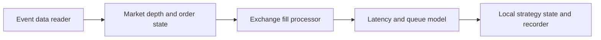
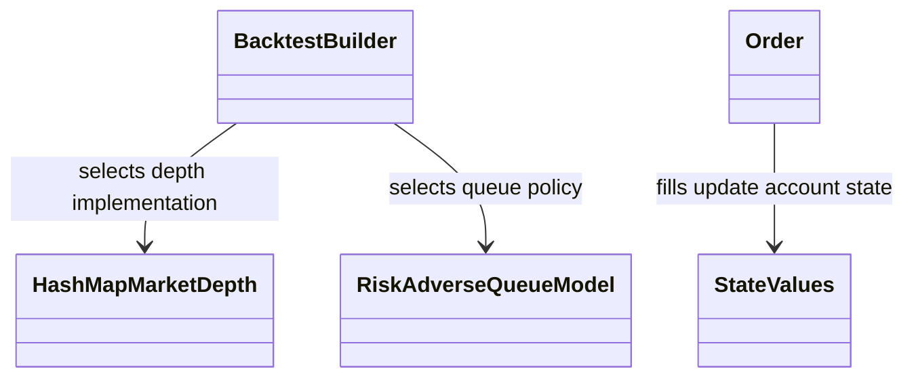
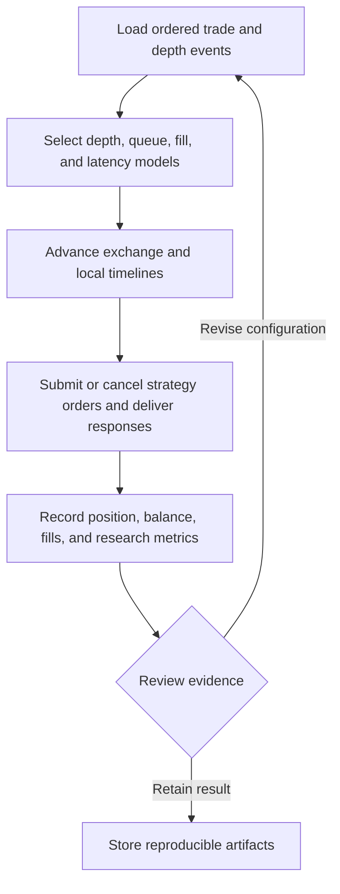
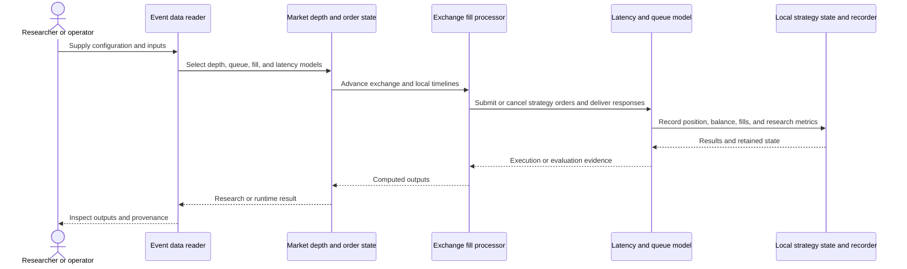
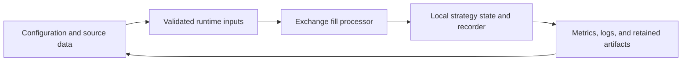
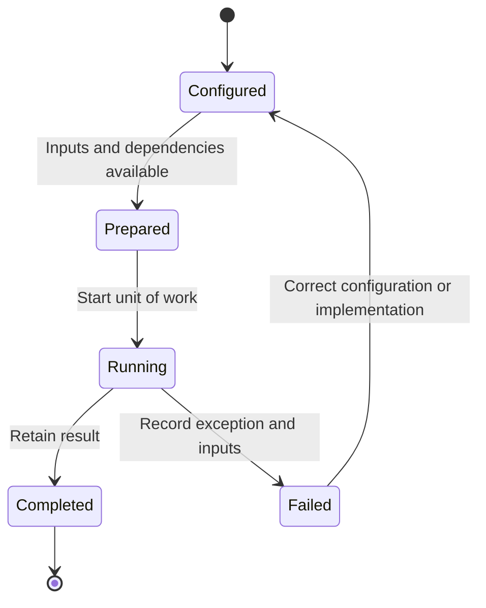

# HFTBacktest: workflow and architecture

Updated 2026-10-12. Source baseline: `9b7a2fdd245dfc4a9997f9427f68aaeb795e19d3` on `feature/ayu_develop`. See [development commands](development.md) and [validation evidence](validation.md) for the tested environment and current limitations.

## Purpose and features

Replays tick-level market data while modeling exchange and local order state, queue position, order latency, depth updates, and execution behavior for high-frequency research.

- L2 and L3 event replay
- Partial-fill and no-partial-fill exchange processors
- Queue-position and latency models
- Multiple market-depth representations
- Python/Numba bridge and Rust-native backtests

## Component architecture

Exchange and local processing are separated so strategy-observed order state can lag simulated exchange state. Queue and latency models determine when a submitted limit order is eligible for execution and when its response reaches the strategy. Different market-depth representations trade memory layout against price-range and update behavior. Fill-model choice is an explicit simulation assumption: replayed public data cannot prove that a hypothetical large order would have had the same market impact.

The diagram shows responsibility boundaries in the main research or execution path. Concrete entry points and implementation files are linked below.

## Core types

The types below belong to the public or native boundary described by the linked implementation. Arrows describe the dependency or ownership relationship used in the documented workflow. Listed Python methods are present in the linked source; native array types represent the binding boundary.

## End-to-end workflow

1. Load ordered trade and depth events.
2. Select depth, queue, fill, and latency models.
3. Advance exchange and local timelines.
4. Submit or cancel strategy orders and deliver responses.
5. Record position, balance, fills, and research metrics.

## Interaction sequence

The sequence follows one unit of work. Results return across the same boundaries that accepted the configuration and data. External I/O and numerical execution have different failure modes and should retain separate evidence.

## Data and artifact lifecycle

Inputs include explicit strategy or model settings, data selection, and execution assumptions. Retaining these with outputs makes a rerun reviewable. Temporary environments and caches remain development artifacts, while source-controlled configuration documents intended behavior.

## Execution and failure boundaries

Backtest datasets, Databento parsing wheels, live IPC components, and exchange connectors are separate runtime or native requirements. The Python package includes a Rust extension and NumPy/Numba integration, so an import-only source check is insufficient to validate the binding.

This state diagram describes the documented workflow, not a claim that these names are an implementation enum. Failure evidence should identify whether input preparation, external services, native compilation, or application execution failed.

## Development layout

The root Cargo workspace and py-hftbacktest maturin package are retained. Python commands use --project py-hftbacktest; this avoids flattening the native workspace or relocating its relative Rust path dependencies.

## Source map

| Existing source | Responsibility evidence |
|---|---|
| [hftbacktest/src/backtest/mod.rs](../hftbacktest/src/backtest/mod.rs#L64) | Implementation and module/type documentation, beginning at line 64 |
| [hftbacktest/src/backtest/data/reader.rs](../hftbacktest/src/backtest/data/reader.rs#L29) | Implementation and module/type documentation, beginning at line 29 |
| [hftbacktest/src/backtest/evs.rs](../hftbacktest/src/backtest/evs.rs#L7) | Implementation and module/type documentation, beginning at line 7 |
| [hftbacktest/src/backtest/models/queue.rs](../hftbacktest/src/backtest/models/queue.rs#L25) | Implementation and module/type documentation, beginning at line 25 |
| [hftbacktest/src/backtest/models/latency.rs](../hftbacktest/src/backtest/models/latency.rs#L14) | Implementation and module/type documentation, beginning at line 14 |
| [hftbacktest/src/backtest/proc/local.rs](../hftbacktest/src/backtest/proc/local.rs#L35) | Implementation and module/type documentation, beginning at line 35 |
| [hftbacktest/src/backtest/proc/partialfillexchange.rs](../hftbacktest/src/backtest/proc/partialfillexchange.rs#L78) | Implementation and module/type documentation, beginning at line 78 |
| [hftbacktest/src/backtest/proc/nopartialfillexchange.rs](../hftbacktest/src/backtest/proc/nopartialfillexchange.rs#L64) | Implementation and module/type documentation, beginning at line 64 |
| [hftbacktest/src/depth/hashmapmarketdepth.rs](../hftbacktest/src/depth/hashmapmarketdepth.rs#L21) | Implementation and module/type documentation, beginning at line 21 |
| [hftbacktest/src/types.rs](../hftbacktest/src/types.rs#L23) | Implementation and module/type documentation, beginning at line 23 |
| [hftbacktest/src/backtest/state.rs](../hftbacktest/src/backtest/state.rs#L7) | Implementation and module/type documentation, beginning at line 7 |
| [hftbacktest/src/backtest/recorder.rs](../hftbacktest/src/backtest/recorder.rs#L33) | Implementation and module/type documentation, beginning at line 33 |
| [py-hftbacktest/src/lib.rs](../py-hftbacktest/src/lib.rs#L66) | Implementation and module/type documentation, beginning at line 66 |
| [py-hftbacktest/pyproject.toml](../py-hftbacktest/pyproject.toml#L5) | Implementation and module/type documentation, beginning at line 5 |

The links target files present in this checkout. Follow their imports and adjacent tests when changing a boundary. The validation document distinguishes successful builds, complete test runs, inherited skips, and unresolved prerequisites.
