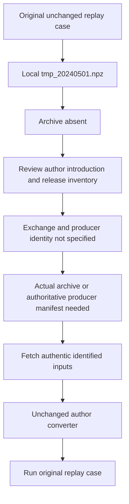

# Original HftBacktest replay input recovery

The original case remains blocked at the absent `tmp_20240501.npz`; it was rerun unchanged on the maintained Python 3.15 environment at source `22095dd6e52b96c329ca8632d90c23a42178b430`. Exactly one existing case failed with `FileNotFoundError`, exit 1, measured wall time 0.47 seconds. No archive was substituted, no converter was run against an inferred instrument, and no source, tests or repository documentation were changed.

## Author source provenance

The filename first appears in the author's [June 29, 2024 Rust-backed Python case](https://github.com/nkaz001/hftbacktest/blob/45e7c8c04696f6bb526e41369bff7ee6259cfc38/tests/test_hftbacktest_ffi.py). It specifies a local archive path, not an exchange, instrument, producer invocation, event count or checksum. Searching all fetched refs for introduction/removal of this filename in Python, Rust and notebook source identifies that introduction and the later July 30 `np.load` addition. No matching archive exists in this checkout, including ignored paths.

Contemporary author [download](https://github.com/nkaz001/hftbacktest/blob/45e7c8c04696f6bb526e41369bff7ee6259cfc38/rust/examples/2_download_tardis.py), [conversion](https://github.com/nkaz001/hftbacktest/blob/45e7c8c04696f6bb526e41369bff7ee6259cfc38/rust/examples/3_convert.py) and [grid-trading](https://github.com/nkaz001/hftbacktest/blob/45e7c8c04696f6bb526e41369bff7ee6259cfc38/rust/examples/gridtrading_backtest.rs) examples use May 2024 Binance futures data. The grid example names `1000SHIBUSDT`, with matching tick/lot settings, but the converter produces `{symbol}_{date}.npz`, and that example consumes `1000SHIBUSDT_20240501.npz` plus a separate SOD snapshot. None maps this output to `tmp_20240501.npz`. These similarities identify a candidate, not the identity of the original Python fixture.

The [author release API](https://api.github.com/repos/nkaz001/hftbacktest/releases?per_page=100&page=1) returned all 41 published releases in one page, with zero attached assets. No original NPZ release asset is supplied. A current upstream [PR #307](https://github.com/nkaz001/hftbacktest/pull/307) independently reports that the broader original suite expects the untracked `tmp_20240501.npz` fixture; it supplies no identity or recovery recipe. That contributor's different-symbol/date/provider replay is not a substitute for this case.

## Authentic publisher access probes

[Tardis documentation](https://docs.tardis.dev/downloadable-csv-files) states that first-of-month historical CSV files can be downloaded without an API key; [Binance futures coverage](https://docs.tardis.dev/historical-data-details/binance-futures) documents the relevant data types and a public sample. The exact documented GET endpoint was tested without credentials.

| GET target | Result | Scope |
|---|---|---|
| `binance-futures/incremental_book_L2/2024/05/01/1000SHIBUSDT.csv.gz` | HTTP 403, Cloudflare blocked page | Inferred candidate only |
| `binance-futures/trades/2024/05/01/1000SHIBUSDT.csv.gz` | HTTP 403, Cloudflare blocked page | Inferred candidate only |
| `binance-futures/trades/2020/02/01/BTCUSDT.csv.gz` | HTTP 403, same Cloudflare blocked page | Publisher's documented sample access control |

The GET probes requested a small byte range solely to check publisher access. They yielded no market data and were never used for replay. Earlier HEAD requests returned 404; that method is not the documented dataset API and is not evidence that the data is absent. The genuine GET 403 response establishes current access failure from this environment, not a permanent data availability or paid-key prerequisite. No CAPTCHA, alternate network or access-control bypass was attempted.

## Exact prerequisites and limits

Recovery requires either the actual author's archive, or a producer manifest identifying its exchange, symbol, exact input interval/files, converter revision/options, snapshot handling and output identity. Once those are established, the unchanged author converter can produce the required `data` structured array from authentic full inputs. The current converter's documented event ordering and the historical script's conversion options also make an unspecified reconstruction insufficient to prove event identity.

For the plausible Tardis route, full genuine trade and incremental-depth inputs for the intended instrument/date and working publisher access are additional prerequisites. The author's first-day script processes the SOD snapshot; the test requires a linear asset, original tick `0.000001`, lot `1.0`, ROI `[0,1]` and the original strategy. Those settings do not uniquely identify an instrument. Renaming a current example archive would therefore conceal the unresolved provenance gap.

The terminal existing-case log and source SHA are in `original-case-terminal.{json,log}`. `source-provenance-gap.json` records author history and source-file hashes. `publisher-availability.json` records release inventory and HEAD probes; `publisher-get-probes.json` records the actual GET failures and documented-sample control. `author-issue-search.json` and `issue307*.json` retain the upstream report and its discussion. No smaller replay is reported as the original case.

## Recovery workflow

The current native build and Rust unit/documentation proofs remain in [validation](../validation.md). This diagnosis does not replace their results or report a different replay as this original case.
